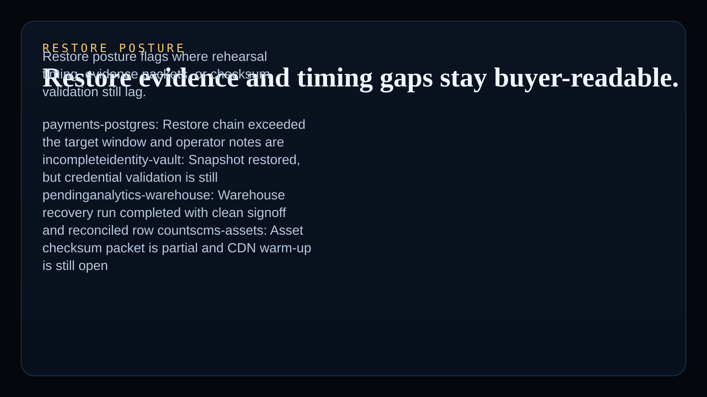

# backup-restore-drill-runner

Bash-native operator surface for SRE, Platform, and infrastructure teams reviewing backup rehearsal timing, restore evidence completeness, recovery blockers, and next-step remediation posture.

## Availability and scope (checked 2026-10-30)

This repository contains a local, synthetic demonstration. The shell script analyzes four hard-coded sample drills and generates static pages; it does not execute a hosted restore or prove that a production system can be recovered.

The configured `backup.kineticgain.com` domain did not resolve during the 2026-10-30 check. The GitHub Pages URL redirected to that domain, so neither URL provided a working public demo in that check. The repo is under retirement review, but no archive, redirect, or replacement has been approved. The `CNAME` and Pages configuration remain in place while incoming links and route behavior are assessed.

## Product depth

- real `Shell / Bash` added to the public Kinetic Gain language atlas with a third distinct primitive
- backup and restore drill decisioning that comes from shell analysis, not a mocked dashboard
- monetizable runbook kits, recovery templates, and embedded resilience consulting hooks
- executive-readable sample restore posture for leaders reviewing the demo's recovery windows
- technical proof that the same shell runner can analyze drill inputs, publish static evidence routes, and package README proof assets without a separate dashboard dependency

## What these repos have in common

Kinetic Gain proof surfaces turn operational data into a repeatable decision layer: a clear risk signal, an accountable owner context, an evidence packet, and a next action. This one focuses on backup and restore resilience, but the pattern matches the broader suite: reduce vague status reporting, make control posture buyer-readable, and keep the public proof tied to working code.

## Operating workflow

1. Run the shell analysis against the synthetic drill register.
2. Generate the static site, sitemap, docs route, and README proof assets from the same source path.
3. Smoke-check every generated route for product depth, common-pattern language, and portfolio interlinks.
4. Review the restore posture by system, target window, actual recovery time, blockers, and recommendation.

## Screenshots





## Routes

- `/`
- `/drill-lane/`
- `/recovery-matrix/`
- `/restore-posture/`
- `/verification/`
- `/docs/`

## Local development

```powershell
bash scripts/run_demo.sh
bash scripts/generate_site.sh
```

## Validation

```powershell
bash test/runtests.sh
bash scripts/smoke_check.sh
bash scripts/render_readme_assets.sh
```

## Safety note

This repo uses synthetic demonstration data only. It is framed as recovery-readiness evidence and does not claim audited disaster-recovery compliance or formal certification.

## Why this matters

Kinetic Gain Embedded tie-back:

The local Bash demo analyzes sample recovery timing and generates operator-readable static routes. Those source capabilities may be reused in runbook kits or embedded resilience work; the current public demo is unavailable as noted above.

## Commercial path

- `Paid runbook kit`
- `Consulting hook`

This can ladder into restore rehearsal packs, backup evidence checklists, resilience review decks, and embedded recovery-governance work for platform and infrastructure teams.

---

Part of the [Kinetic Gain operator portfolio](https://kineticgain.com/) · docs: [suite.kineticgain.com](https://suite.kineticgain.com/)
